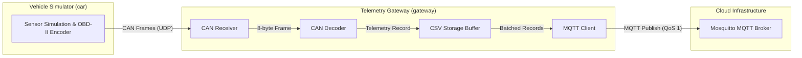

# Connected Vehicle Edge Telemetry Gateway

Linux edge telemetry gateway written in C++17 for connected vehicles. Ingests CAN bus telemetry frames, decodes standard OBD-II metrics using bitwise calculations, maintains offline local persistence with a FIFO ring buffer, and synchronizes batches to an MQTT broker with QoS 1.


## Architecture Overview



### Data Flow
1. **Vehicle Simulation (`car`)**: Computes vehicle metrics (RPM, Speed, Coolant Temperature) across acceleration, deceleration, and idle states. Encodes data into standard 8-byte OBD-II CAN frames.
2. **Gateway Ingestion (`gateway`)**: Receives binary CAN frames over a local UDP socket.
3. **CAN Decoding (`decoder`)**: Reads the binary payload and computes metrics according to SAE J1979:
   - **Engine RPM** (`PID 0x0C`): 2-byte calculation `((A * 256) + B) / 4.0` with 0.25 precision.
   - **Vehicle Speed** (`PID 0x0D`): 1-byte value in km/h.
   - **Coolant Temperature** (`PID 0x05`): 1-byte value with -40 offset (`A - 40` °C).
4. **Local Persistence Buffer (`storage`)**: Stores telemetry sequentially on disk. Enforces a FIFO retention limit (`MAX_STORAGE_RECORDS = 500`) to prevent local storage saturation during network outages.
5. **MQTT Cloud Synchronization (`mqtt_client`)**: Reads records in chunks (`MAX_CHUNK_SIZE = 100`) and publishes them to the broker with QoS 1. Sent records are removed from disk once transmission succeeds.

## Key Features

- **Offline-First Resilience**: Handles network drops cleanly. Telemetry continues buffering to local storage without blocking data ingestion.
- **FIFO Disk Protection**: Automatically evicts the oldest records when storage capacity is reached, ensuring storage space remains bounded.
- **Automated Verification**: Integrated unit test suite verifying CAN decoding math and storage retention limits.
- **Process Orchestrator**: Python runner managing compilation, process startup, log streaming, and clean `SIGINT` shutdown.


## Project Structure

```text
├── CMakeLists.txt          # Root CMake build configuration with CTest integration
├── runner.py               # Process orchestrator and execution runner
├── car.hpp / car.cpp       # Vehicle physics engine and CAN frame emitter
├── decoder.hpp / decoder.cpp # Bitwise CAN OBD-II message decoder
├── storage.hpp / storage.cpp # CSV persistence buffer with FIFO eviction
├── mqtt_client.hpp / .cpp  # Mosquitto MQTT client wrapper with QoS 1
├── main.cpp                # Telemetry gateway service entry point
└── tests/
    ├── test_can.cpp        # CAN decoding and bitwise calculation assertions
    └── test_storage.cpp    # FIFO eviction and chunk removal assertions
```


## Prerequisites

- **Linux / WSL2** (Ubuntu 20.04+ recommended)
- **Compiler**: GCC / G++ with C++17 support
- **Build System**: CMake (>= 3.16)
- **Packages**:
  ```bash
  sudo apt-get update
  sudo apt-get install -y build-essential cmake libmosquitto-dev mosquitto mosquitto-clients python3
  ```
  - `build-essential` & `cmake`: C++ compiler and build automation.
  - `libmosquitto-dev`: C/C++ development headers and libraries required to compile the gateway.
  - `mosquitto`: Local MQTT broker daemon.
  - `mosquitto-clients`: Command-line tools (`mosquitto_sub`) to inspect MQTT topics.
  - `python3`: Required to run the orchestrator script.


## Building and Running

### Method 1: Using the Python Orchestrator (Recommended)

The runner script configures CMake, builds the project, and starts the simulator and gateway together:

```bash
python3 runner.py
```

Press `Ctrl+C` to trigger a clean shutdown of both processes.

### Method 2: Manual Build with CMake

```bash
# Configure and build
cmake -B build
cmake --build build

# Start the Mosquitto broker service (if not already running)
sudo systemctl start mosquitto

# Run the vehicle simulator in the background
./build/car &

# Run the telemetry gateway service
./build/gateway
```

To monitor telemetry messages arriving at the broker, open a second terminal and subscribe to the topic:
```bash
mosquitto_sub -t "vehicle/telemetry" -v
```


## Running Automated Tests

Tests are integrated with CMake and executed using CTest:

```bash
cmake --build build
ctest --test-dir build --output-on-failure
```

### Test Coverage
- **`TestCan`**: Verifies 2-byte RPM calculation precision (0.25 resolution), vehicle speed parsing, and negative/positive coolant temperature offsets.
- **`TestStorage`**: Verifies sequential disk storage, FIFO record eviction when buffer capacity is reached, and batch chunk retrieval and removal.
